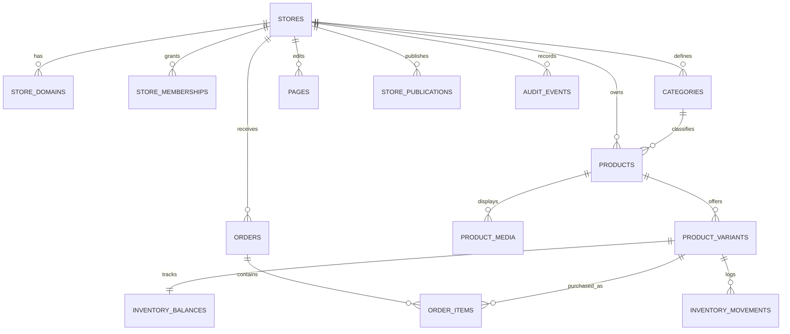

# ADR-0001 — Database design for AFTERFORM multi-store engine

**Status:** Proposed (not deployed)  
**Date:** 2026-11-23  
**Decision owner:** AFTERFORM  
**Frontend contract:** [bootstrap-contract.md](./bootstrap-contract.md)

## Decision

Use **managed PostgreSQL (16+) as the transactional system of record**, with a **hybrid relational + JSONB schema**.

- **Relational:** tenants, members, categories, products, variants, inventory balances, orders, order line snapshots, audit events.
- **JSONB:** per-industry product attributes, variant options, store theme/settings, editor page blocks, published public bootstrap payload.
- **Object storage/CDN:** product images and campaign videos; database stores URLs / metadata only.
- **Stateless afterform-be:** sole public/API authority; frontend has no DB credentials.
- **Cache later:** CDN for public bootstrap; Redis only after workload demonstrates a need.

**Deployment options:** Supabase managed Postgres for an inexpensive, fast MVP with built-in dashboard; AWS RDS for PostgreSQL if tight AWS/VPC integration, operations and centralized CloudWatch Database Insights are required. **Same SQL schema / migrations** for both, subject to provider-specific role and extension checks.

## Why not NoSQL first?

| Requirement | PostgreSQL + JSONB | MongoDB Atlas | DynamoDB |
| --- | --- | --- | --- |
| Different product schemas per industry | JSONB attributes + normalized variants | Excellent document fit | Flexible item model |
| Atomic stock and orders | Native SQL transactions and constraints | Transactions supported; multi-document schema discipline needed | Transactions supported; keyed access design needed |
| Owner-level tenant isolation | Composite foreign keys, auth scopes, optional RLS | Application filters / document access policy | Tenant-partitioned keys and policy design |
| Ad-hoc financial reports | SQL joins / aggregates / BI | Aggregation pipeline | Extra projection or analytics pipeline often needed |
| Operational visibility | pg_stat_statements + provider dashboard | Atlas monitoring / profiler | CloudWatch request, throttle and capacity metrics |
| Changing access patterns early | Flexible SQL queries | Flexible queries | Partition-key/GSI design matters from day one |

MongoDB would be a reasonable alternative if AFTERFORM became **primarily a flexible content/catalog service** with limited checkout and joins. DynamoDB would be attractive if request patterns become stable and very high volume with a mostly AWS serverless architecture. Neither warrants extra modeling or migration complexity for this MVP.

## Logical entity map



**Physical DDL:** [../db/migrations/0001_initial_design.sql](../db/migrations/0001_initial_design.sql). The DDL is a reviewable **design proposal**, not yet applied or verified on a PostgreSQL instance.

## Multi-tenant rules

1. Every business-owned record carries `store_id`, not just product UUID. Natural keys are scoped to a store (e.g. `UNIQUE(store_id, slug)`, `UNIQUE(store_id, sku)`).
2. Compound foreign keys such as `(store_id, product_id) -> products(store_id, id)` reject cross-store linking even when a programmer passes an otherwise valid ID from another tenant.
3. Backend resolves tenant from **verified domain or requested store slug**, then checks authenticated membership + role for admin actions. Never trust a client-supplied `store_id` alone.
4. No direct database/browser access. Use a dedicated least-privilege DB role; keep the `app` schema private / outside exposed Data API schemas. Add and test row-level security policies before any direct-client database access; table-owner and privileged roles may bypass RLS.
5. `store_memberships.user_id` is an external identity-provider ID; introduce provider mapping/claims validation when real auth is implemented.
6. Avoid cascade deletes for financial records. Suspend/archive stores/products instead of hard-deleting historical order references.
7. Payment statuses are assigned by trusted backend events (e.g. verified provider webhooks), never by client-supplied `paid` flags.

## Flexible industry attributes

`products.attributes` is schemaless at storage layer, but validated **per industry/template in the backend**.

Fashion product:

```json
{"material":"cotton","fit":"oversized","care":["cold-wash"],"gender":"unisex"}
```

Beauty product:

```json
{"skinTypes":["dry","combination"],"ingredients":["hyaluronic-acid"],"spf":30}
```

Variants use `product_variants.option_values`:

```json
{"size":"M","color":"black"}
```

or:

```json
{"volume":"30ml"}
```

The **current frontend API contract supports only one selectable option axis** (e.g. `size` or `volume`). The database already supports multi-axis options, but the backend must project supported choices until UI catches up. Normalize fields actually used in joins, filters, pricing and inventory; keep long-tail attributes JSONB. Product `base_price` and variant `price_override` are decimal numbers (no float money).

## Read model and publishing

Writer flow (future): `draft products/pages/settings -> validate -> assemble public bootstrap JSON -> insert store_publications(version,payload) -> update stores.published_version` **in one transaction**.

Reader flow for `GET /api/v1/public/stores/{storeSlug}/bootstrap`:

1. Find an `active` store by unique slug.
2. Resolve `published_version` and read its public `store_publications.payload`.
3. Compose/refresh current saleability and available-to-sell stock from authoritative tables **if checkout mode requires it**. Do not use stale cached snapshot as the stock source for order placement.
4. Reply with the exact `store`, `products`, `home` and `looks` structure already specified by the frontend contract.
5. Cache with ETag/version where practical; invalidate on publish. Unknown/unpublished store returns `404`.

Snapshots contain **only public** brand, product and content fields. Never include member records, cost prices, personal order information, secrets or internal audit logs. A zero-product published catalog is a valid response; do **not** substitute dummy fashion items.

## Inventory / order transaction (future, not implemented)

- An order is idempotent by a client/request token scoped to `store_id`.
- Inside a single DB transaction, lock or conditionally update each stock balance. For simple immediate purchase, a guarded `UPDATE ... WHERE on_hand - reserved >= :qty RETURNING ...` is a viable building block.
- Insert immutable order-item product/price snapshots and inventory movement records; commit together. On insufficient stock, abort the entire transaction. Payment confirmation, refunds, reservations, expired holds and webhook retries require explicit state machines and idempotent handling.
- The current `order_items` and `inventory_movements` tables are placeholders for this implementation; not a complete payment or reservation design.
- Do not auto-mark orders `paid`, and do not accept public frontend mock checkout as a payment operation.

## Scaling strategy

| Stage | Data layer | Trigger to move on |
| --- | --- | --- |
| MVP, handful of stores | Single managed Postgres, app connection pool, indexes, CDN public assets, daily monitored backups | Slow queries, pool exhaustion or sustained database load |
| Growing read traffic | Optimize EXPLAIN plans, selective JSONB indexes, compact public snapshots, CDN/ETag; read replica if needed | Writes/locks or replica lag become bottlenecks |
| High order volume | Queue async workflows; isolate reports from OLTP; consider partitioning large audit/order-event tables by time with data retention | Confirmed lock/contention or storage problems |
| Very large multi-tenant platform | Separate heavy tenant databases, partition/shard by store, introduce dedicated search/analytics pipelines | Measured tenant hotspots and operational trade-offs justify it |

Do **not** partition/shard every table from day one. Optimize actual query shapes first. Indexes accelerate reads but add storage and write cost. Use UUIDs for identifiers, `TIMESTAMPTZ` for timestamps (UTC in application), and a bounded database connection pool.

## Operations, security and restore

- Monitor DB CPU/memory, storage, I/O, active/idle connections, connection-pool saturation, replication lag, long-running transactions, deadlocks, p95/p99 API latency, failed publishes and inventory conflict rates.
- Use provider metrics + application OpenTelemetry. For query hotspots, use `pg_stat_statements`, explain plans and appropriate slow query logging. Avoid logging PII, addresses, access tokens and customer emails in SQL logs or traces.
- Enable automated backups and **test restore**; Point-in-Time Recovery should be included before taking real orders. A free hosted tier is not a substitute for a verified recovery process.
- Store all credentials in backend secret management. Encrypt database connections, restrict network access and DB roles. Implement per-store audit events for admin changes.
- Monitor tenant isolation with integration tests (two stores, identical product slugs, cross-tenant IDs) and application logging keyed by safe `store_id`, not customer identity.

## Acceptance criteria for next implementation PR

- [ ] A new store with fashion schema and a beauty store can coexist with no shared products, cart data or admin access.
- [ ] Cross-tenant FK inserts fail, even with an existing UUID from another store.
- [ ] Dynamic `attributes` are validated by industry-specific JSON Schema.
- [ ] Draft edits don't change the public response until publish; publishing is versioned/atomic.
- [ ] Empty published catalog returns `products: []`; invalid/nonexistent store returns 404.
- [ ] Public bootstrap matches the frontend contract including variant projection and currency.
- [ ] Backend-only access, scoped auth, safe logs, backup/restore and monitoring are implemented and tested.
- [ ] No live payment or customer data is accepted by demo endpoints.

## References (primary documentation)

- PostgreSQL JSONB: https://www.postgresql.org/docs/current/datatype-json.html
- PostgreSQL RLS: https://www.postgresql.org/docs/current/ddl-rowsecurity.html
- PostgreSQL pg_stat_statements: https://www.postgresql.org/docs/current/pgstatstatements.html
- Supabase Observability: https://supabase.com/docs/guides/observability
- Supabase Connection Pooling: https://supabase.com/docs/guides/database/connecting-to-postgres/pooling-and-limits
- RDS CloudWatch Database Insights: https://docs.aws.amazon.com/AmazonRDS/latest/UserGuide/USER_DatabaseInsights.html
- MongoDB Atlas metrics: https://www.mongodb.com/docs/atlas/monitor-cluster-metrics/
- DynamoDB monitoring: https://docs.aws.amazon.com/amazondynamodb/latest/developerguide/Monitoring-metrics-with-Amazon-CloudWatch.html
