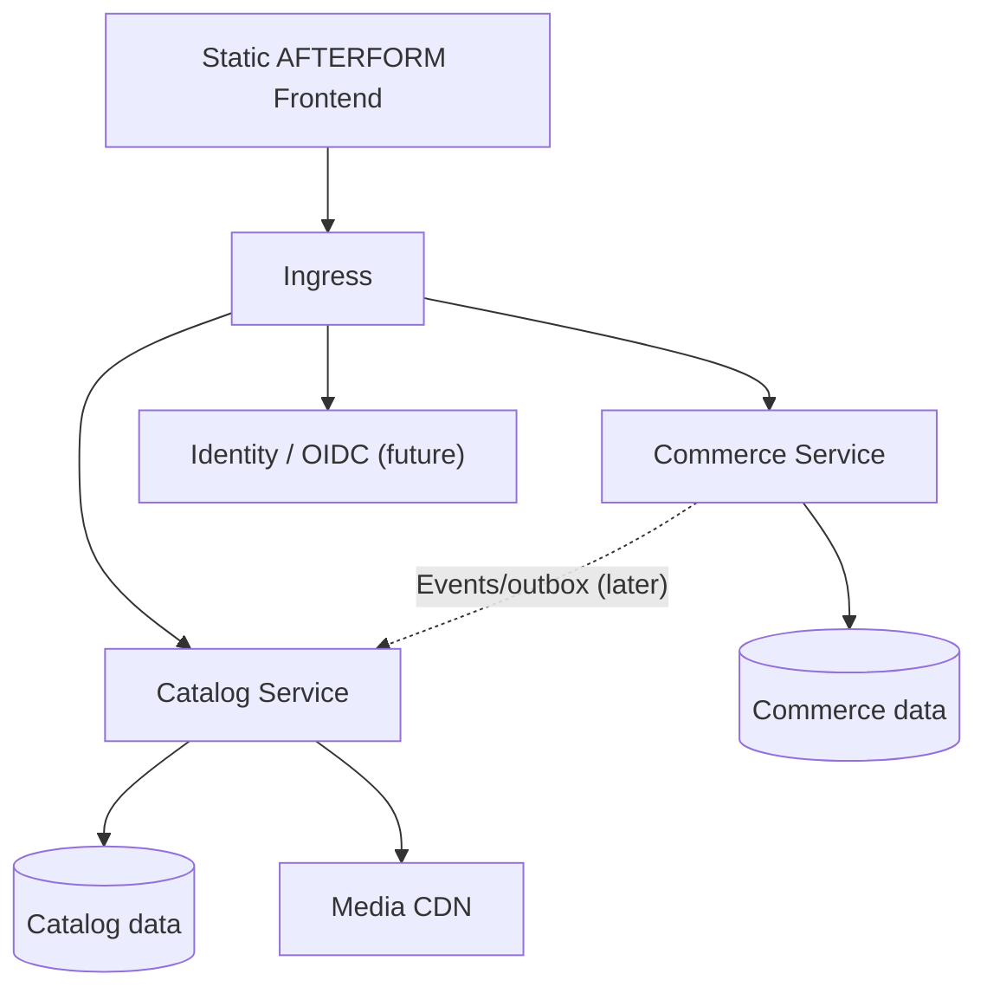

# ADR-0002 — AFTERFORM Java microservices

Status: **Accepted for implementation** (2026-11-23). Tracks [#2](https://github.com/trminhkhoi76-code/afterform-be/issues/2).

## Stack decision

- **Java 25 LTS**, e.g. Eclipse Temurin JDK/JRE, with regular security patch rebuilds.
- **Spring Boot 4.1.3** (maintained patch line), Spring Framework 7, Spring MVC, Micrometer/Actuator.
- **Maven reactor** with independently executable applications; Java `--release 25` and CI on Temurin 25.
- **PostgreSQL 16+** and Flyway-managed catalog/commerce migrations; no JPA magic schema generation in production.
- **Edge**: one ingress/reverse proxy (eventual gateway/rate limiting) instead of mandatory always-on discovery/Eureka/config-server JVMs.
- **Auth**: OIDC JWT resource-server in each protected service; no credentials stored in the frontend.
- Use OpenTelemetry traces and Prometheus-compatible metrics after core endpoints work.

Spring Boot 4.2.0 GA was published 2026-11-19, but 4.1.3 released on 2026-11-20 is selected as a conservative production baseline on an established minor line; re-evaluate Boot 4.2.x after integration soak and dependency audits. Java 27 is non-LTS, so do not target it for production deployments.

Sources: https://spring.io/blog/2026/11/20/spring-boot-4-1-3-available-now/ ; https://spring.io/blog/2026/11/19/spring-boot-4-2-0-available-now/ ; https://docs.spring.io/spring-boot/4.1/system-requirements.html ; https://www.oracle.com/java/technologies/java-se-support-roadmap.html

## Service boundaries

| Deployment | Responsibility (exclusive writer) | Public surface |
| --- | --- | --- |
| `catalog-service` | Stores/tenants, domain routing, catalog, categories, products, media metadata, templates, pages, publish snapshots | `GET /api/v1/public/stores/{slug}/bootstrap`; admin APIs later |
| `commerce-service` | Inventory balances/reservations/movements, orders, pricing snapshots, payment events and refunds | Checkout/admin APIs **later** |
| `identity-service` **future** | User identity integration and store memberships/role policy; prefer external OIDC provider | Issuer/JWKS and role lookups later |
| Edge ingress (no Java service required) | TLS, routing, CORS defense-in-depth, rate limits, logging correlation | Public `/api/v1/**` |

**Database ownership:** Existing `db/migrations/0001_initial_design.sql` (ADR-0001) is a **logical full-domain proposal**, not a migration every service may run. Once implemented, `catalog-service` owns catalog tables and publication snapshot in its own DB/schema. `commerce-service` owns balances/orders and does not join catalog tables via SQL. Each domain gets separate roles/migrations and potentially a separate DB instance later. The POC may share one PostgreSQL *server* but not SQL table access. Avoid JPA shared entities across services.

**Inventory rule:** one authoritative balance in commerce. Public catalog snapshots may contain an eventually consistent availability read model, but checkout must synchronously validate/reserve via commerce. Do not copy `app.inventory_balances` as a shared writable table in multiple services.

**Dataflow**

## Interfaces and resilience

1. Public bootstrap remains **exactly** `GET /api/v1/public/stores/{storeSlug}/bootstrap`, `200` with `store/products/home/looks` and `404` for absent/unpublished. Empty products is valid; do not return fashion dummy from backend. Frontend owns its own dummy fallback.
2. Catalog UI is read-only until authenticated admin endpoints are implemented. A bootstrap publication is immutable and only references public media.
3. No cross-service synchronous request in the public bootstrap hot path in MVP. Read precomputed catalog publication; inventory may be stale but cannot authorize payment.
4. Event delivery is eventually consistent using an outbox when needed; never use distributed database transactions.
5. Service-to-service authentication is mTLS or signed service identity through trusted platform before exposing internal operations. Public endpoints only where intended.
6. Explicit timeouts, retries **only** for safe idempotent operations, circuit breaking where justified; structured errors with request IDs, no PII.

## Security, scaling and operations

- Store tenant identity resolved server-side; admin identity comes from validated OIDC token and verified membership, not client `store_id`.
- Independent container images, Java 25 LTS, non-root execution, liveness/readiness probes and resource caps. CI on all PRs; no deploy without explicit environment approval.
- PostgreSQL managed with bounded Hikari pool; pg_stat_statements, slow-query analysis, PITR/restore drills before real checkout.
- Ingress-to-service network segmentation; minimal actuators externally (health only); do not expose env, beans, heapdump or config endpoints.
- Use one small DB instance for initial cost optimization; split physical databases or add broker only after measured demand.

## Phased implementation and exit criteria

- Phase 0: [#2](https://github.com/trminhkhoi76-code/afterform-be/issues/2) ADR and [#3](https://github.com/trminhkhoi76-code/afterform-be/issues/3) independently running skeleton apps.
- Phase 1: [#4](https://github.com/trminhkhoi76-code/afterform-be/issues/4) catalog Flyway ownership; [#5](https://github.com/trminhkhoi76-code/afterform-be/issues/5) public API integration.
- Phase 2: [#6](https://github.com/trminhkhoi76-code/afterform-be/issues/6) auth, [#7](https://github.com/trminhkhoi76-code/afterform-be/issues/7)-[#9](https://github.com/trminhkhoi76-code/afterform-be/issues/9) admin and publish.
- Phase 3: [#11](https://github.com/trminhkhoi76-code/afterform-be/issues/11)-[#13](https://github.com/trminhkhoi76-code/afterform-be/issues/13) commerce, stock, payments, with verified webhooks.
- Supporting tracks: edge, observability, Docker deployment, consumer contracts and outbox: [#14](https://github.com/trminhkhoi76-code/afterform-be/issues/14)-[#18](https://github.com/trminhkhoi76-code/afterform-be/issues/18).

Do not declare the system production-ready until all security, restore, payments and operational checks are verified.
